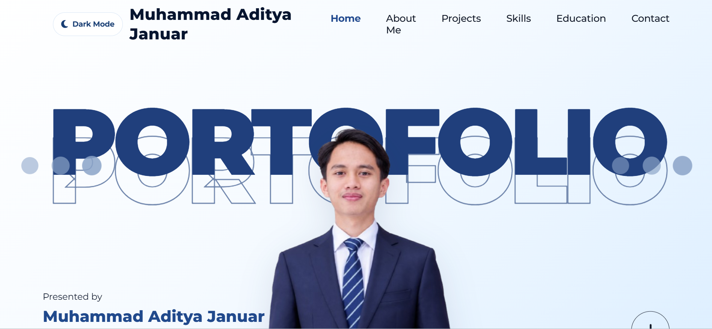
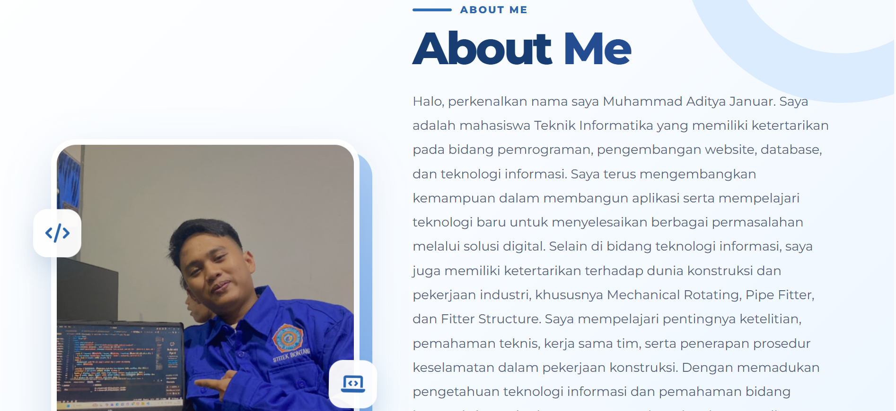
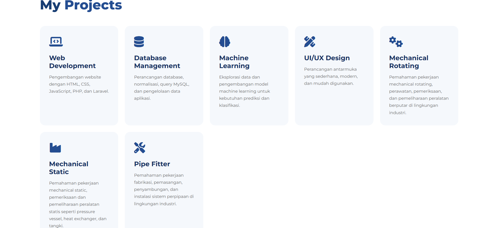
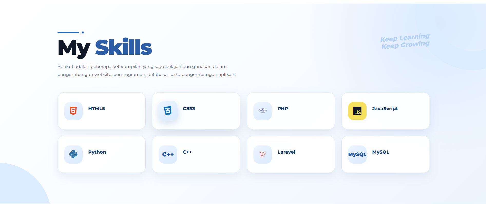
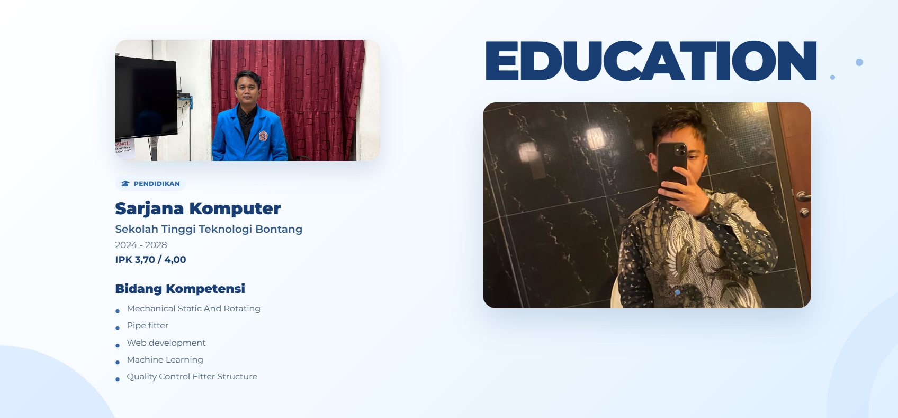
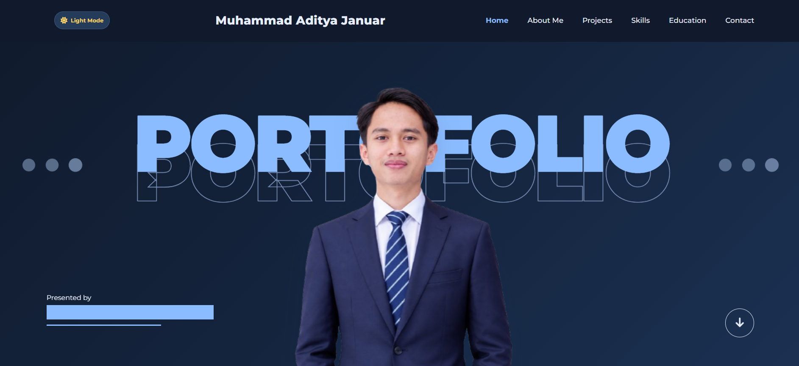

# Personal Website – Muhammad Aditya Januar

## 1. Deskripsi Project

Personal Website merupakan website portofolio pribadi yang dikembangkan menggunakan React JS. Website ini dibuat sebagai media untuk memperkenalkan profil diri, menampilkan keterampilan, pengalaman, bidang kompetensi, serta hasil pengembangan project.

Website ini dirancang dengan tampilan modern, sederhana, dan interaktif sehingga pengunjung dapat mengenal latar belakang serta kemampuan yang dimiliki.

## 2. Fitur Website

Berikut beberapa fitur yang tersedia pada website:

1. **Home**  
   Menampilkan halaman utama dengan identitas dan foto profil.

2. **About Me**  
   Menampilkan informasi pribadi, latar belakang pendidikan, serta ketertarikan di bidang teknologi informasi dan industri.

3. **My Projects**  
   Menampilkan bidang project dan kompetensi, meliputi:
   - Web Development
   - Database Management
   - Machine Learning
   - UI/UX Design
   - Mechanical Rotating
   - Mechanical Static
   - Pipe Fitter

4. **My Skills**  
   Menampilkan keterampilan dalam bidang pemrograman dan teknologi, seperti HTML, CSS, JavaScript, PHP, Python, C++, Laravel, dan MySQL.

5. **Education**  
   Menampilkan informasi riwayat pendidikan di Sekolah Tinggi Teknologi Bontang (STITEK Bontang), Program Studi Teknik Informatika.

6. **Contact**  
   Menyediakan informasi kontak untuk memudahkan pengunjung menghubungi pemilik website.

7. **Dark Mode**  
   Menyediakan pilihan tampilan terang dan gelap yang dapat disesuaikan oleh pengunjung.

8. **Interactive Animation**  
   Menggunakan animasi untuk memberikan pengalaman navigasi yang lebih menarik.

## 3. Teknologi yang Digunakan

Project ini dikembangkan menggunakan beberapa teknologi berikut:

| Teknologi | Kegunaan |
|---|---|
| React JS | Library untuk membangun antarmuka website |
| JavaScript | Mengatur logika dan interaksi website |
| HTML5 | Membentuk struktur halaman |
| CSS3 | Mengatur tampilan dan desain website |
| Vite | Development server dan build project |
| Font Awesome | Menampilkan ikon pada website |
| LocalStorage | Menyimpan pilihan tema Dark Mode |

## 4. Struktur Folder Project

Struktur folder utama project:

```text
portofolio-react/
│
├── node_modules/
│
├── src/
│   ├── public/
│   │   └── foto/
│   │       └── aditya.jpg.png
│   │
│   ├── App.jsx
│   ├── App.css
│   ├── index.css
│   └── main.jsx
│
├── index.html
├── package.json
├── package-lock.json
├── vite.config.js
└── README.md
```

## 5. Cara Instalasi

Sebelum menjalankan project, pastikan perangkat sudah memiliki:

- Node.js
- NPM
- Visual Studio Code

Langkah instalasi:

**1. Clone repository**

```bash
git clone https://github.com/USERNAME/REPOSITORY.git
```

**2. Masuk ke folder project**

```bash
cd portofolio-react
```

**3. Install dependencies**

```bash
npm install
```

## 6. Cara Menjalankan Website

Setelah proses instalasi selesai, jalankan perintah:

```bash
npm run dev
```

Kemudian buka browser dan akses alamat:

```text
http://localhost:5173/
```

Website akan berjalan melalui server lokal Vite.

## 7. Dokumentasi Website

### 1. Halaman Home


### 2. Halaman About Me


### 3. Halaman My Projects


### 4. Halaman My Skills


### 5. Halaman Education


### 6. Halaman Contact


### 7. Tampilan Dark Mode

Screenshot dapat disimpan di dalam folder `docs/screenshots/` dan ditampilkan pada bagian ini.

## 8. Tujuan Pembuatan

Tujuan pembuatan Personal Website ini adalah untuk memenuhi tugas Ujian Tengah Semester (UTS) mata kuliah Pemrograman Berbasis Framework sekaligus mengimplementasikan penggunaan React JS dalam membangun sebuah website pribadi yang interaktif.

## 9. Identitas Pengembang

| Keterangan | Informasi |
|---|---|
| Nama | Muhammad Aditya Januar |
| NIM | 202412049 |
| Program Studi | Teknik Informatika |
| Perguruan Tinggi | Sekolah Tinggi Teknologi Bontang |
| Mata Kuliah | Pemrograman Berbasis Framework |
| Project | Personal Website |

---

**Dibuat oleh Muhammad Aditya Januar**

*Personal Website – React JS Project*
